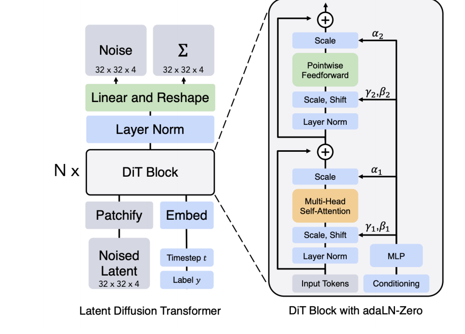

# DiT DIY · 从零实现一个小型 Diffusion Transformer

一个以 **MNIST 手写数字条件生成**为目标的 PyTorch 学习项目：手写 patchify、多头自注意力、时间/位置编码与条件调制，逐步搭建从噪声到图像的生成过程，并扩展到 VAE 潜空间。实现过程中使用了生成式 AI 辅助。

项目保留简洁的原始实现，另提供可复现的训练入口，负责配置、验证集、EMA、检查点与图像导出。它是教学规模的 DiT-inspired 实现，并非原论文的完整复现。

## v0.1.0 实测结果


本机 CPU 完成 60 轮像素空间 Flow Matching 训练，模型仅 **168,784 参数**。固定验证集 EMA MSE 为 **0.18557**；独立生成的 **1,000 张图**中，分类器与请求类别的一致率为 **99.1%**（95% Wilson 区间 98.30%–99.53%）。评估分类器在 MNIST 官方测试集上的准确率为 98.59%。

上图未筛选样本，每类 10 张。类别一致率是辅助指标，不等于感知质量或多样性；数字 9 的一致率为 94%，仍存在与 7 混淆的情况。完整设置、逐类结果和训练曲线见 [实验报告](docs/EXPERIMENT.md)。

仓库附带约 0.7 MB 的 [EMA 推理权重](pretrained/mnist-flow-ema.pt)。安装依赖后，无需重新训练即可生成：

```bash
python experiment.py --sample pretrained/mnist-flow-ema.pt --output outputs/pretrained_samples
```

参数见 [训练配置](configs/mnist_flow_cpu.json)，改动范围见 [CHANGES.md](docs/CHANGES.md)。

## 功能

- **Transformer 图像骨干**：patch embedding、二维正弦位置编码、时间编码、带零初始化门控的条件调制。
- **类别条件生成**：支持数字 0–9；训练时以 10% 概率丢弃标签，采样时使用 classifier-free guidance（CFG）。
- **两条生成路径**：线性路径 Flow Matching + Euler ODE；三角函数噪声路径 + 噪声预测 + SDE。
- **Latent diffusion 实验**：卷积 VAE 将 `1×28×28` 图像映射到 `4×7×7` 潜变量。
- **实验记录**：独立 JSON 配置、固定验证集、原始/EMA 权重、优化器与随机状态、逐轮指标、固定种子样例。

## 快速开始

使用 Python 3.11，先安装匹配的 PyTorch / torchvision，再安装其余依赖。以下命令从仓库根目录运行：

```bash
git clone https://github.com/intethan8-art/DiT-DIY.git
cd DiT-DIY
python -m venv .venv
# Windows PowerShell: .venv\Scripts\Activate.ps1
# Linux / macOS: source .venv/bin/activate
python -m pip install -r requirements.txt
python experiment.py --config configs/mnist_flow_cpu.json --output outputs/my_run
```

第一次使用会通过 torchvision 下载 MNIST 到 `data/`。实验默认自动检测 CUDA；可加 `--device cpu` 或 `--device cuda` 指定设备。原始演示脚本仍按原样使用 CPU。

配置中的训练上限为 60 轮、2,700 秒，时间预算在每轮开始时检查，因此可能多用一轮及最终采样的时间。实际耗时依赖硬件。默认训练 55,000 张图像，留出 5,000 张验证图像，官方 10,000 张测试图像不参与生成器训练或检查点选择。

### 保存与恢复

```bash
# 从最近一个完整 epoch 恢复；必须使用同一份配置和输出目录
python experiment.py --config configs/mnist_flow_cpu.json --output outputs/my_run --resume outputs/my_run/latest.pt

# 从最佳 EMA 权重生成 100 张图；每一行依次为数字 0–9
python experiment.py --sample outputs/my_run/best.pt --output outputs/my_samples
```

新训练拒绝覆盖非空输出目录。恢复会计入已消耗的训练时间；已达到配置上限的运行不会额外训练。检查点保存的是 epoch 边界状态，不支持精确恢复到中断的 batch。不同设备/库版本可能产生数值差异。

| 输出文件 | 内容 |
| --- | --- |
| `config.json` | 实际使用的训练与采样配置 |
| `metadata.json` | Python/PyTorch 版本、Git 状态、源文件 SHA-256、数据拆分说明 |
| `metrics.jsonl` | 每轮训练 MSE、固定噪声验证 MSE、学习率和耗时 |
| `latest.pt` | 最近一轮模型、EMA、优化器、调度器、随机状态 |
| `best.pt` | 按最低 EMA 验证 MSE 选择的检查点 |
| `samples_epoch_*.png` | 固定种子训练过程样例 |
| `samples.png` / `samples.pt` | 最佳检查点的生成网格 / 原始输出张量 |
| `summary.json` | 完成原因、训练轮数、选中轮次与耗时 |

若安装了 `wandb`，实验会按配置默认写入本地离线 W&B 记录；未安装时直接保存本地 JSON 日志。不会自动上传实验数据。

### 验证实验工具

```bash
python -m unittest discover -s tests -v
```

测试覆盖中断后恢复与连续训练的权重一致性，以及两种采样路径的形状、有限值和随机状态隔离。

### 独立评估

```bash
# 在相同 train/validation 拆分上训练一个独立 CNN，按验证准确率选取权重
python evaluate.py --train-classifier --output outputs/evaluator

# 默认额外生成 1,000 张图（每类 100 张），评估类别一致性
python evaluate.py --checkpoint outputs/my_run/best.pt --output outputs/my_run/evaluation
```

评估报告包含分类器在官方测试集上的准确率、生成图的类别一致率、95% Wilson 区间、逐类准确率与混淆矩阵。生成图会裁剪到 `[-1, 1]` 后输入分类器，与展示范围一致。

**类别一致率不是 FID，也不能单独代表视觉质量、多样性或不存在记忆训练样本。** 当前实验只使用一个生成器训练种子；区间仅表示这批采样的统计不确定性，不包含训练种子间差异。

## 模型与训练目标

```text
图像 x_t ── Patchify ── Linear + 2D Position Encoding ──┐
                                                      ├─ Transformer Blocks ─ Linear ─ Unpatchify
时间 t ─── Sin/Cos Encoding ── MLP ────────────────────┤
类别 y ─── Embedding（含 null label=10）───────────────┘
```

CPU 配置使用 `P=4`、`D=64`、4 个注意力头、2 个 block、MLP 宽度 256。28×28 图像对应 49 个 token，模型共 168,784 个参数。模型结构与原始 `train.py` 相同。

| 路径 | 训练输入 | 预测目标 | 必须配套的采样器 |
| --- | --- | --- | --- |
| Flow Matching | `x_t = t·x + (1−t)·ε` | 速度 `x−ε` | `sample_ode` |
| Noise prediction | `x_t = sin(πt/2)·x + cos(πt/2)·ε` | 噪声 `ε` | `sample_sde` |

两种路径的时间均从噪声端 `t≈0` 走向数据端 `t≈1`。不能将噪声预测权重直接交给速度 ODE 采样器。CFG 使用 `prediction_uncond + w·(prediction_cond − prediction_uncond)`；`w=1` 为普通条件预测。

新实验配置采用已有的 Flow Matching 路径，Adam 初始学习率 `1e-3`、cosine 衰减至 `1e-4`、batch size 128、EMA decay 0.995、100 步 ODE、CFG 2.0。EMA 与调度器由独立实验入口提供，原始模型与 `trainer.train_step` 保持不变。

## 原始演示入口

```bash
python train.py         # 像素空间，噪声预测 + SDE，训练后弹窗展示数字 3
python train_vae.py     # 训练 VAE，保存 outputs/vae.pt，弹窗展示重建
python latent_train.py  # 先准备上述 VAE 权重，再训练 latent DiT
```

原始脚本是教学演示：参数写在代码内，`train.py` / `latent_train.py` 不保存 DiT 权重，绘图需要交互式显示环境。`experiment.py` 当前支持像素空间两种目标，不负责 latent 训练。Latent 路径仍为探索实现，VAE 重建效果不能代替完整生成效果验证。

## 目录

```text
model.py / layers.py        DiT、注意力、编码和条件调制
patch_utils.py              Patchify / Unpatchify
flow.py / sampler.py        概率路径与 ODE / SDE 采样
trainer.py / data.py        原始训练步骤与 MNIST 数据加载
VAE.py / vae_trainer.py      卷积 VAE 与重建/KL 损失
train*.py / latent_train.py  原始演示入口
experiment.py               独立可复现训练、恢复与采样入口
evaluate.py                 独立分类器与条件生成评估
configs/                    可复现实验配置
docs/                       实验报告与环境记录
```

数据和中间权重默认由 `.gitignore` 排除，避免训练输出进入源码历史。

## 开发历程

- 09/29：MLP 生成流程。
- 10/05：Transformer 图像骨干。
- 10/06：SDE 与噪声预测。
- 10/08：Classifier-free guidance。
- 10/12：接入 VAE，探索 latent diffusion。
- 10/13：新增独立实验入口、配置保存、验证与发布文档。

早期生成示例（历史实验，未记录完整参数，不能作为本次可复现结果）：



## 参考

- [Scalable Diffusion Models with Transformers — Peebles & Xie](https://arxiv.org/abs/2212.09748)
- [Flow Matching for Generative Modeling — Lipman et al.](https://arxiv.org/abs/2210.02747)

本项目实现服务于学习和小规模实验；发布结果应连同配置、数据拆分和评估限制一起阅读。
