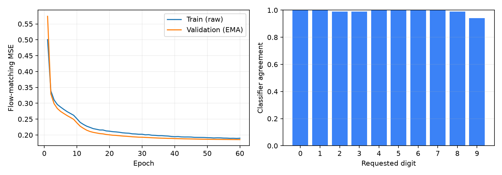
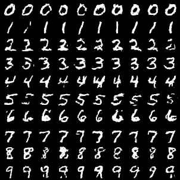

# MNIST CPU 实验记录

## 设置

本次使用原有 `model.DIT`、`trainer.train_step`、`flow.make_flow_pair` 和 `sampler.sample_ode`，没有改动模型主体。实验入口新增了 EMA、cosine 学习率调度、固定验证集与检查点管理。

- 数据：MNIST 官方训练集以 seed=42 拆分为 55,000 张训练图和 5,000 张验证图；官方测试集不参与生成器训练或选择。
- 模型：168,784 参数，patch=4、width=64、depth=2、heads=4、MLP=256。
- 优化：Adam，batch=128，初始 lr=0.001，cosine 最低 lr=0.0001，EMA=0.995，标签丢弃概率=0.1。
- 采样：100 步 Euler ODE，CFG=2；展示 seed=2026；评估使用从 seed=9876 开始的分批独立噪声。
- 环境：CPU，4 个训练线程；版本与源文件哈希见 [metadata.json](results/metadata.json)。
- 选型：只按固定噪声验证集的最低 EMA MSE 选择，不按展示图挑选检查点或样本。

## 实测结果

| 项目 | 结果 |
| --- | --- |
| 完成轮数 | 60 |
| 选中轮次 | 60 |
| 停止原因 | `epochs_complete` |
| 训练过程墙钟耗时（含等待） | 40.02 分钟 |
| 初始轮验证 MSE | 0.573965 |
| 最佳 EMA 验证 MSE | 0.185569 |
| 独立分类器官方测试准确率 | 98.59%（10,000 张） |
| 生成图类别一致率 | 99.10%（1000 张） |
| 95% Wilson 区间 | 98.30%–99.53% |

每类生成 100 张，没有按分类器置信度或外观筛图。

第 43 轮记录了 1004.2 秒的异常耗时。运行期间工具等待也出现长延迟，因此墙钟时间包含环境等待，不能视作纯计算耗时。

| 请求类别 | 类别一致率 |
| --- | --- |
| 0 | 100.0% |
| 1 | 100.0% |
| 2 | 99.0% |
| 3 | 99.0% |
| 4 | 100.0% |
| 5 | 100.0% |
| 6 | 100.0% |
| 7 | 100.0% |
| 8 | 99.0% |
| 9 | 94.0% |



下图每行依次为 0–9，每类固定噪声生成 10 张，使用最佳 EMA 权重。



## 复现

```bash
python experiment.py --config configs/mnist_flow_cpu.json --output outputs/reproduce
python evaluate.py --checkpoint outputs/reproduce/best.pt --classifier pretrained/mnist-classifier.pt --output outputs/reproduce/evaluation
python experiment.py --sample pretrained/mnist-flow-ema.pt --output outputs/pretrained_samples
python -m unittest discover -s tests -v
```

发布权重为推理用 EMA 权重；完整可恢复检查点保留在本地 `outputs/mnist_flow_cpu/latest.pt` 和 `best.pt`。配置、逐轮指标、环境记录、数据与权重 SHA-256 位于 [results/](results/)。导出命令为 `python export_results.py`。

## 解读与限制

类别一致率衡量独立 CNN 是否把生成图识别为请求类别，不是 FID，也不能证明感知质量、风格多样性或无训练集记忆。应结合上方未经筛选的网格查看残余噪点和形状错误。

本次只训练一个生成器随机种子；Wilson 区间不包含不同训练种子的差异。分类器使用生成器相同训练/验证拆分训练 5 轮，按验证准确率选型，再在官方测试集报告准确率。没有为此实验训练或验证 latent DiT；本地已有 VAE 权重不属于本次生成质量结论。

原有代码与外围工具的改动范围见 [CHANGES.md](CHANGES.md)。
